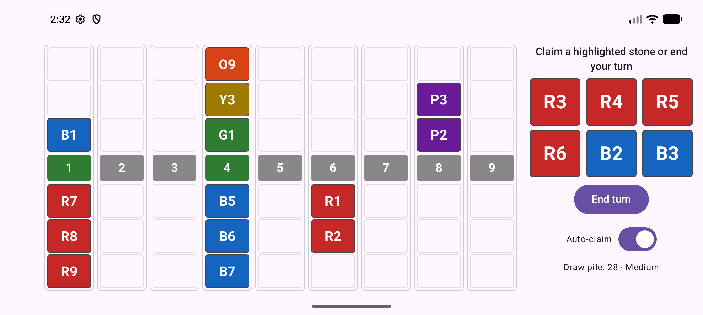

# Stone Capture

[](https://github.com/lbruand/stone-capture/actions/workflows/ci.yml)
[](app/build.gradle.kts)
[](gradle/libs.versions.toml)
[](app/src/main/kotlin/io/stonecapture/GameScreen.kt)
[](gradle/wrapper/gradle-wrapper.properties)
[](SPECS/SPEC.md)
[](https://github.com/lbruand/stone-capture/commits/main)

A two-player card duel for Android, played against a bot. Build three-card formations in front of nine stones and capture enough of them to win.

<p align="center">
  
</p>

## How to play

- Nine stones sit in a row. Each stone has three card slots on your side and three on the opponent's.
- On your turn you place one card on a stone, optionally claim stones you can prove are yours, then draw a card.
- A full side is a formation. From strongest to weakest: straight flush, three of a kind, flush, straight, then anything else. Within the same formation the higher sum wins, and if sums tie, whoever finished first wins.
- You can claim a stone once your side is full and the opponent cannot possibly beat it with the cards still unseen. Your own hand does not count as proof.
- Win by owning **five stones**, or **three stones in a row**.

The full rules, decisions and roadmap are in [SPECS/SPEC.md](SPECS/SPEC.md).

## Features

- Landscape board with large cards and highlighted playable or claimable stones
- Easy and Medium bots
- Optional auto-claim
- Autosave: the game in progress and your settings survive restarts
- Pure Kotlin rules engine, testable without Android

## Project layout

| Module | What it holds |
|--------|---------------|
| [`core`](core) | Rules engine, formation scoring, claim proof, bots, save format. Pure Kotlin/JVM, no Android dependencies. |
| [`app`](app) | Android app: Jetpack Compose UI, `GameViewModel`, DataStore persistence. |
| [`SPECS`](SPECS) | Specification and design decisions. |

## Build and run

Requirements: JDK 21 and the Android SDK (platform 37, build-tools 36.0.0). Point Gradle at the SDK with `sdk.dir` in `local.properties` or the `ANDROID_HOME` variable.

```sh
./gradlew :core:test          # rules engine and bot tests
./gradlew :app:lintDebug      # Android lint
./gradlew :app:assembleDebug  # builds app/build/outputs/apk/debug/app-debug.apk
```

Install on a running emulator or device:

```sh
adb install -r app/build/outputs/apk/debug/app-debug.apk
adb shell am start -n io.stonecapture/.MainActivity
```

Debug builds accept a saved position for inspection: `adb shell am start -n io.stonecapture/.MainActivity --es saved_game '<json>'`. The JSON is the output of `SaveCodec.encode` in `core`. Release builds ignore it.

## Continuous integration

Every push to `main` and every pull request runs [`.github/workflows/ci.yml`](.github/workflows/ci.yml): core tests, Android lint and a debug build. There is no release or deployment pipeline yet.

## Roadmap

Done: rules engine, Easy and Medium bots, landscape UI, difficulty choice, autosave, auto-claim, CI.
Next: accessibility, a how-to-play screen, animations and sound, an app icon, a Hard bot, pass-and-play and a store release. See the milestones in the [spec](SPECS/SPEC.md).

## Legal

Stone Capture is an independent game. It reimplements generic card-duel mechanics, which are not protected by copyright, and uses its own name, artwork and text. It is not affiliated with any other game or publisher. No license has been chosen for the code yet.
